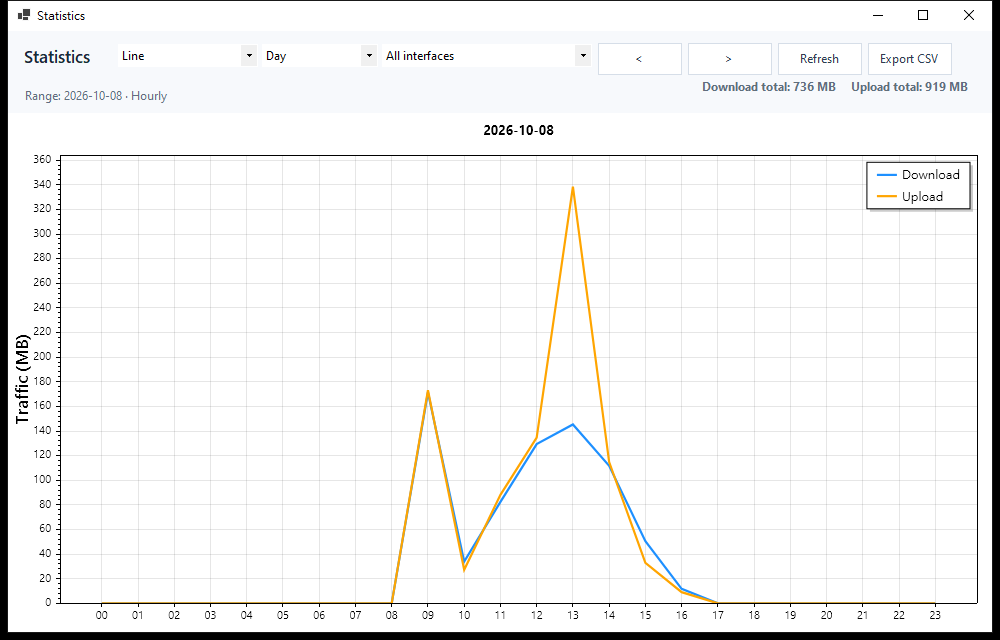
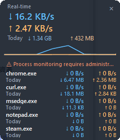
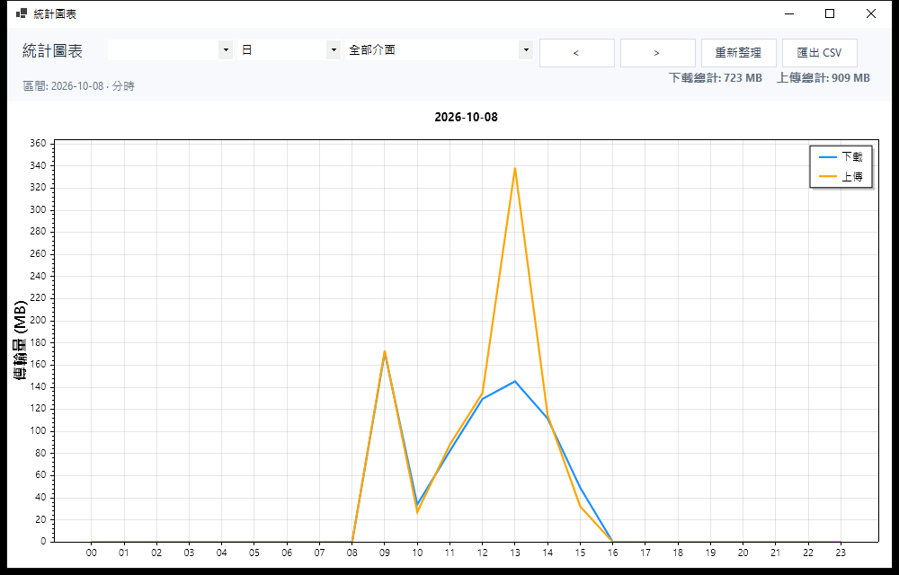

# Network Monitor 蝬脰楝??蝔?


[English](README.md) | **蝜?銝剜?**

Windows 蝟餌絞??虜擏??單?蝬脰楝瘚???撌亙嚗銝€?瑁?瑼€? CPU??閮擃?
撠??雯頝臭??Ｙ?銝??喲?閮???SQLite嚗蒂?批遣?????湔??絞閮?踴€?隞?舀蝜?銝剜??????€?
![銝餉?蝒(screenshots/main.png)

## ?

| 憿 | 隤芣? |
|---|---|
| ?單??? | 瘥??見?雯頝臭??Ｙ?銝?嚗??喲€?嚗蜓閬?蝬脫?頂蝯勗?內?單??湔 |
| 蝟餌絞??虜擏?| ??閬?敺葬?喟頂蝯勗蝜潛??瑁?嚗ray ?內憿舐內?桀?蝮賡€? |
| 瘚桀??Ｘ | ?€?撠?蝵桅??Ｘ嚗＊蝷箏?€???*隞蝝舐??唾撓??*??90 蝘粥?ｇ??舀??喋€???銝餉?蝒€?菟?殷? |
| 蝯梯??” | **????*嚗嚗???嚗€梧??嚗????嚗?**?湔???*嚗嚗€梧??蜇?€蝭拚?桐?隞???????????CSV |
| 鞈?閮? | 瘥??Ｘ???銝€蝑神??SQLite嚗AL 璅∪?嚗??身靽? 180 憭拙隤?|
| ???? | 銝€?萄神??`HKCU\...\Run` ?駁???|
| 銝剛??| tray ?詨?身摰?蝒?????⊿??? |
| 雿?皞?| 閬??鉀?](#?) |
| **蝔???**嚗1.1嚗?| 瘥?蝯梯?**?孵?蝔?**嚗? chrome.exe嚗?銝?頛?銝餉?蝒?摨?銵剁??€???單???嚗??伐??祆活蝝航?嚗€?憭???5 ?€??誑 `P:蝔?? ?萄神?亙?銝€ SQLite ?”嚗???銝€蝑?嚗絞閮?銵其??Ｖ???湔?貊?撘鼓?€?*?€隞亦頂蝯梁恣??瑁?**嚗TW `Microsoft-Windows-Kernel-Network`嚗CP+UDP/IPv4+IPv6 ?券?蝎曄Ⅱ嚗??芣?甈?蝔?甇?虜??嚗?其??Ｘ?蝷?|
| **蝣潸”蝯梯?**嚗1.1嚗?| 銝餉?蝒€ ??蝯梯?嚗 ?迫蝯梯???蝝航?銝€畾菜???銝?嚗??喟蜇??蝯??神??SQLite嚗絞閮?蝒??孵??箸???????嚗?????嚗?頛?銝嚗?靽?????`retentionDays` |

## ?恍?芸?

| 蝯梯??”嚗?? | 瘚桀??Ｘ |
|---|---|
|  |  |

| 蝯梯??”嚗?擃葉?? | |
|---|---|
|  | |

## 蝟餌絞?€瘙?
- Windows 10嚗?9041 隞乩?嚗? Windows 11嚗?*x64嚗遣霅堆???x86**
- **摰????芸??*嚗?€摰?隞颱??辣
- **portable ??*嚗?撌脣?鋆?.NET 10 Desktop Runtime嚗銝?](https://dotnet.microsoft.com/download/dotnet/10.0)嚗?- **蝔???嚗1.1嚗?*嚗?閬?*蝟餌絞蝞∠???*?瑁?嚗TW嚗??芣?甈??園??甇?虜嚗?撘??其??Ｘ?蝷箔蒂???誑蝞∠??∟澈???啣??€?
## 摰??孵?

### 摰?蝔?嚗遣霅堆?

1. ??[Releases](https://github.com/caronyang/network-monitor/releases) ??頛?   `NetworkMonitor-1.1.1-x64-setup.exe`嚗?2 雿?蝟餌絞隢?頛?`-x86-setup.exe`嚗?2. ?瑁?摰?嚗?鋆?蝔?暸嚗?   - ???銵冽敺??箏?撱箇?嚗€??Ｘ敺??貊嚗?   - **???????*嚗神?亥?蝔??折?璈???????駁??潘?
   - 摰?蝎暸??舀?望???擃葉????3. 銋??舐 *Windows 閮剖? ???蝔?* 閫?摰?嚗?   鞈?嚗%LOCALAPPDATA%\NetworkMonitor`嚗?*閫?摰???靽?**??
### ??鋆?嚗ortable嚗?
??[Releases](https://github.com/caronyang/network-monitor/releases) ??頛?`NetworkMonitor-1.1.1-portable-x64.zip`嚗圾憯葬敺銵?`NetworkMonitor.exe`
嚗? .NET 10 Desktop Runtime嚗€?
?銵銵?`publish-portable.bat`嚗ramework-dependent嚗?`publish-selfcontained.bat`
嚗?鋆?.NET嚗???頛詨鞈?憭曉銵?`NetworkMonitor.exe`??航?祉??亙? `x64` ??`x86` ?嚗?閮?`x64`嚗€?
## 雿輻隤芣?

### 銝餉?蝒?
- **撌亙????*嚗蝯梯??”` ?絞閮?銵具€閮剖?` ?身摰?蝣潸”蝘餉**閬??€銝**???€嚗?銝?嚗?  隤?隢 tray ?詨?身摰?蝒????€撠??刻?蝒???園?
- **瘛梯????*嚗otal ?單?蝮賡€??oday嚗??亦敞閮?瘥?45 蝘?鞈?摨急?堆???  Session嚗甈∪??敞閮?
- **蝔?????*嚗1.1嚗?`??蝔? (n/5)` + `?啣??圳嚗??箏銵葉蝔?嚗??詨??亦?扳??殷?嚗?  ?芯誑蝞∠??∪銵?憿舐內蝺???`???€閬恣?甈?` ?內嚗???**敶撠店獢?*閰Ｗ??臬????
- **蝔?蝬脫**嚗1.1嚗???? ??撘??箇嚗?瘥?憿舐內蝔???憒?`chrome.exe`嚗€銵??€?  ?單?銝?嚗??喲€??撠€脣漲璇€??亥??祆活蝝航?嚗?*???撖砍??脣?**嚗?嚗銵葉??  ?堆??芸銵?撠望蝘駁閫貊???耦皜豢??over 擃漁嚗?銝???撠??嚗?甈⊿＊蝷?3 ??
  頞??舐**?脣?**瑼Ｚ?
- **隞蝬脫**嚗???*???見???脣?**嚗?憿舐內????€??蝬?撌脤€???嚗???嚗?  銝暺?嚗??亥??臭??Ｗ?蝔晞€€???????頛?銝???撠€脣漲璇€??亥??祆活蝯梯?
- **蝣潸”??*嚗1.1嚗?蝒?摨嚗?`????蝯梯?`嚗???迫蝯梯?` 蝘餃?ㄐ嚗?憪絞閮???
  憿舐內???€???單?蝝航?嚗??00:00:37 ??4.7 MB ??210 KB`嚗?
### 蝟餌絞????喃?閫?

- **??**嚗＊蝷箔蜓閬?
- **?喲?詨**嚗＊蝷箔蜓閬?嚗絞閮?銵剁?瘚桀??Ｘ嚗?璈????隤?嚗身摰?蝯?蝔?
- **?詨??內**嚗?蜇銝?嚗??喲€?嚗? 5 蝘?堆?

### 蝯梯??Ｘ

- ?”嚗?????湔??
- ??嚗?匝嚗???00-23嚗€?常嚗??伐???嚗???30 憭抬?
- 靘?嚗?券隞`嚗銝€隞嚗?*?桐???蝔?**嚗1.1嚗? `chrome.exe (蝔?)`嚗?- `<` `>` ??銝???銝???`F5`嚗????萎??舀?雿?- `?臬 CSV` ?臬?桀??€????- **?單?蝯梯?蝝€??*嚗1.1嚗?蝒??對?嚗??箸?甈∠Ⅳ銵函絞閮?
  ?????????€???蜇銝??蜇銝

### 瘚桀??Ｘ

?€?蝵桅?撠?選?憿舐內?單?銝?嚗??喲€???*隞蝝舐??唾撓??*??90 蝘粥?Ｕ€??箇?憭批???v1.0 ?詨?嚗?44?118嚗??嗆???蝔???韏啣銝**??瘥€?撘??€憛?*
嚗?蝔晞€???????亦敞閮??€憭?5 ??嚗?輯??擃????潔蝙?典摰?雿祝摨佗?
**??銝?頞?Ｘ?楠**???喟宏?€???銝餉?蝒€?菟?柴€?` ??桅??€?蝵格?閮??


## 鞈??身摰?蝵?
```
%LOCALAPPDATA%\NetworkMonitor\
  networkmonitor.db                        SQLite嚗AL嚗raffic 隞+P:蝔??easurement 蝣潸”嚗?  settings.json                             閮剖?嚗 processMonitors ??蝔?皜嚗?憭?5嚗?  crash.log                                 ?啣虜閮?
  etw_selftest.txt                          ETW ?芣葫頛詨嚗?-etw-selftest ?Ｙ?嚗?```

`settings.json` 銝餉?甈?嚗?
| 甈? | 隤芣? | ?身 |
|---|---|---|
| `language` | `en` / `zh` | `en` |
| `autoStart` | ???芸??瑁? | `false` |
| `floatingPanel` | 憿舐內瘚桀??Ｘ | `false` |
| `sampleIntervalMs` | ?見??嚗?00-60000嚗?| `1000` |
| `retentionDays` | ??鞈?靽?憭拇嚗?-3650嚗?| `180` |
| `includeLoopback` | ? 127.0.0.1 | `false` |
| `includeDisconnected` | ??芷€??隞 | `false` |
| `showFilterAdapters` | 憿舐內撠?蝭拚隞 | `false` |
| `processMonitors` | 蝔???皜嚗?撖思???`.exe`嚗?憭?5 ?? | `[]` |

### ?隞蝭拚嚗?閬?

Windows 蝟餌絞撣豢? 50+ ?€???Ｕ€?WFP?pcap?oS?瘥?擃? filter ?拚??剁?嚗?摰€?*?∪???隞賣???*??券憿舐內嚗?銝€隞賢???鋡恍?銴?蝞?甈～€?
?祉?撘?閮哨?

1. **?撠?蝭拚隞**嚗MIB_IF_ROW2.Flags` bit1嚗€??踹???閮?嚗?刻身摰葉??憿舐內
2. **??€???*??*??芷€??隞** ???臬閮剖?銝剝???3. **? RAS/VPN ??WAN Miniport**嚗indows ?芸??賢???`Local Area Connection* N`嚗?€?€??* N`嚗€?瘞賊?憿舐內?箏歇???雿??⊥???
?迨甇?虜??銝??Ｘ??桀???箇?甇??撖阡?嚗??祉雯頝臬嚗???憭芰雯頝胯€€i-Fi????
## ?

撖行葫嚗璈?Windows 10嚗elease 撱箇蔭嚗ntel 獢?蝝?CPU嚗?

| ?€??| CPU | 閮擃?|
|---|---|---|
| 銝餉?蝒閬?| 蝝?1.7 - 8 %嚗?瘙箸?單?瘚?撣嗅???蝜芷??雿??祕皜?1.7 - 1.9 %嚗?| 蝝?65 - 75 MB |
| 銝餉?蝒???頂蝯勗嚗?| 蝝?0.04 - 0.2 %嚗祕皜?0.12 %嚗?| 蝝?67 MB |

銝餉?蝒閬???CPU 銝餉?瘨€??潸?????蝬脫?鼓???迨????迤?賊?嚗?瘚?頞??鼓頞蝜?CPU 頞?嚗?瘚??? 1.7 %嚗?瘚????鼓??擃? 8 %??
雿?皞??閮剛?嚗?
- ?見??`GetIfTable2` P/Invoke嚗甈∠? 1 ms嚗颲?`NetworkInterface` API 敹怎? 47 ??
- ?函?雿???瑁?蝺?璅??UI ??桐? 1 Hz 閮??冽???∟憚餈渲??舀陬
- ?芰鼓蝬脫?芸**?詨€潛?????*??蝜迎??蔭??瘨€鼓??CPU嚗??GDI 蝑嚗蝑?- SQLite 瘥???甈∪?鈭斗?嚗AL嚗??∟??臬神?亙?撜?- tray ?內瘥?5 蝘?唬?甈∴???閬?

## 敺?憪Ⅳ撱箇蔭

?€閬?[.NET SDK 10.0](https://dotnet.microsoft.com/download/dotnet/10.0)嚗?摰?瑼?€ [Inno Setup 6](https://jrsoftware.org/isinfo.php)嚗?
```bat
build.bat                            :: 撱箇蔭 Release嚗rc\NetworkMonitor\bin\Release\...嚗?publish-portable.bat [x64|x86]       :: ??鋆??冗??framework-dependent嚗? 46 MB嚗? .NET Desktop Runtime嚗?publish-selfcontained.bat [x64|x86]  :: ?芸???冗嚗??€?格?璈?鋆?.NET嚗? 163 MB嚗?build-installer.bat                  :: ?Ｙ? x64 + x86 摰?瑼?-> publish\installer\
```

? Visual Studio ?? `NetworkMonitor.sln`嚗??湔?瑁?嚗?
```powershell
dotnet run --project src\NetworkMonitor -c Release
```

## ?撌亙嚗ools\嚗?
| 瑼? | ?券€?|
|---|---|
| `make_icon.ps1` | ?Ｙ? `assets\app.ico`嚗? 蝔桀偕撖賂? |
| `build.bat` / `publish-*.bat` / `build-installer.*` | 撱箇蔭?雿?摰?瑼?穿?雿撠??寧?? |
| `measure.ps1` | ?葫?芋撘?CPU嚗NM_NOPAINT` 閮箸?文?嚗?|
| `IfTableTest\` | `GetIfTable2` ??`NetworkInterface` 甇?Ⅱ?改??撠撌亙 |
| `ApiDump\` | Windows API 蝯?甈? dump嚗??潭??剁? |
| `ApiIntrospect\` | ScottPlot API ???Ｙ揣 |
| `shot.ps1` `shoth.ps1` `shotpw.ps1` `opengraphics.ps1` | UI ?芸?嚗shotpw` 韏?PrintWindow嚗???蝒?蔣?選? |
| `enumwin.ps1` `uiclick.ps1` `uidump.ps1` `uicheck.ps1` `uicombo.ps1` `clickkeys.ps1` `sendkeys2.ps1` `uielement.ps1` `uiclose.ps1` | 閬???嚗??????? dump嚗?憛?雿?銝??賊???嚗漣璅??嚗葫閰衣嚗?|
| `clickbtn.ps1` | 靘揣撘???蝒??嚗楊隤?嚗??喃葉???嚗?|
| `asciiart.ps1` `rawprof.ps1` `textink.ps1` `pixcheck.ps1` `measuretext.ps1` | ??撽?嚗??? ASCII嚗€?憓刻楚??嚗???摮?蝵殷?蝬脫??嚗extRenderer ???葫 |
| `dumpstat.py` | 閫?? `uidump.ps1` 頛詨 |
| `cleanup_db.py` | 皜鞈?摨思葉??銴??Ｙ???|
| `dllcheck.py` | 瑼Ｘ撱箇蔭?Ｙ?臬?急?摰?銝莎?撽? build ??嚗?|

?啣?霈閮箸?文?嚗??砌蝙?刻??輯身摰?嚗?
- `NM_NOPAINT=1`嚗歲??1 Hz ?鼓嚗? `grid` / `summary` / `tray`嚗?刻歲????蝜芯?皞?嚗?潮??Ｙ鼓???砍????
- `NM_STATS="chart=bar period=week offset=-1"` ??蝯梯?閬??????”嚗€望?嚗??詨?蝘鳴??冽??孵??恍?€??`chart`: `line`|`bar`嚗period`: `day`|`week`|`month`嚗offset`: ?湔嚗? ?箸?€?1 ?箔?銝€??

## ??圾

- **蝔?瘝????€€**嚗??`%LOCALAPPDATA%\NetworkMonitor\crash.log`
- **隞皜瘝???隞**嚗閮剖? ????閮剖?嚗??€??急??????Ｕ€????怠??祟?訾??Ｕ€?- **?詨??極雿恣?銝?**嚗極雿恣?憿舐內?瘥€?摨?瘚?嚗蝔?憿舐內?**瘥€雯頝臭???*?蜇瘚?嚗??急???撘?
- **??蝟餌絞敺?鞈?**嚗?? `%LOCALAPPDATA%\NetworkMonitor\`嚗???荔?蝔???蝥?- **??撘?折?閬頂蝯梁恣?甈???*嚗TW ?詨?蝬脰楝????閬?甈????Ｖ???  ?誑蝞∠??∟澈???啣??€??誑蝞∠??∪銵敺€?甈?蝔???蝡??
- **蝔?銵＊蝷箝€?典銵€?????*嚗府銵?撘???銵?甇瑕鞈????亦敞閮?甇?虜憿舐內嚗?- **撽? ETW ?臬?舐**嚗誑蝞∠??∪銵?`NetworkMonitor.exe --etw-selftest` 敺??  `%LOCALAPPDATA%\NetworkMonitor\etw_selftest.txt`

## ?€銵ㄖ

- C# / .NET 10 WinForms嚗net10.0-windows10.0.19041`嚗???Windows 獢嚗64/x86嚗?- [ScottPlot 5.1.59](https://scottplot.net/) 蝯梯??”
- [Microsoft.Data.Sqlite 10.0.12](https://learn.microsoft.com/ef/core/providers/sqlite/) + SQLite WAL
- Windows `GetIfTable2`嚗phlpapi嚗/Invoke ?見
- [TraceEvent 3.2.8](https://github.com/microsoft/perfview) 瘨祥 `Microsoft-Windows-Kernel-Network` ETW嚗1.1 蝔???嚗?
## ??

[MIT](LICENSE) 穢 2026 Caron Yang
