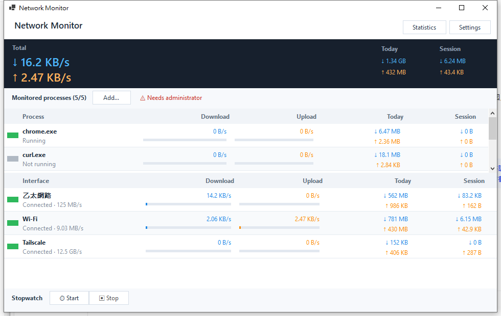

# Network Monitor 網路監控程式


[English](README.md) | **繁體中文**

Windows 系統匣常駐的即時網路流量監控工具：單一執行檔、低 CPU、低記憶體，
將每個網路介面的上下傳量記錄到 SQLite，並內建折線圖／直條圖統計面板。
介面支援繁體中文與英文即時切換。

**重點功能（v1.1）：單一程式的吞吐量監控與記錄** — 可挑選最多 5 個執行中的程式
（例如 `chrome.exe`），**即時監控並逐分鐘記錄**其下載／上傳吞吐量：主視窗顯示即時速率
與今日／本次累計，資料寫入同一 SQLite（可用統計圖表查詢），浮動面板也會為每個程式
疊加一個區塊。精確的程式中流量來自 Windows 核心 ETW 網路提供者（TCP + UDP、
IPv4 + IPv6，含 QUIC/HTTP3），需以**系統管理員**執行。



## 功能

| 類別 | 說明 |
|---|---|
| 即時監控 | 每秒取樣各網路介面的下載／上傳速率，主視窗網格與系統匣提示即時更新 |
| 系統匣常駐 | 關閉視窗後縮至系統匣繼續執行；tray 提示顯示目前總速率 |
| 浮動面板 | 半透明小型置頂面板，顯示即時速率、**今日累積傳輸量**與 90 秒走勢（可拖曳、雙擊開主視窗、右鍵選單） |
| 統計圖表 | **折線圖**：日（分時）／週（分日）／月（分日）；**直條圖**：日／週／月總量。可篩選單一介面、◀▶ 切換期間、匯出 CSV |
| 資料記錄 | 每介面每分鐘一筆寫入 SQLite（WAL 模式），預設保留 180 天可調 |
| 開機啟動 | 一鍵寫入 `HKCU\...\Run` 登錄項 |
| 中英文 | tray 選單或設定視窗即時切換，無需重啟 |
| 低資源 | 見下方[效能](#效能) |
| **程序監控**（v1.1） | **監控並記錄單一程式的吞吐量**：挑選最多 5 個執行中的程式（如 `chrome.exe`），看即時下載／上傳與今日／本次累計。資料以 `P:程式名` 鍵、**每分鐘一筆**寫入同一 SQLite 量表，統計圖表的來源下拉可直接選程式繪圖與匯出 CSV。**需以系統管理員執行**（ETW `Microsoft-Windows-Kernel-Network`，TCP+UDP／IPv4+IPv6 精確全量）；未提權時其餘功能正常，介面會提示 |
| **碼表統計**（v1.1） | 主視窗「⏱ 開始統計／⏹ 停止統計」：累計一段時間的下載／上傳總量，結束時寫入 SQLite，統計視窗下方列出所有紀錄（開始／結束／時間／下載／上傳），保留期間同 `retentionDays` |

## 畫面截圖

所有截圖皆使用英文介面（介面語言可即時切換）。

| 主視窗 | 浮動面板 |
|---|---|
|  |  |

| 統計圖表與碼表紀錄 |
|---|
|  |

## 系統需求

- Windows 10（19041 以上）或 Windows 11，**x64（建議）或 x86**
- **安裝版／自含版**：無需安裝任何元件
- **portable 版**：需已安裝 .NET 10 Desktop Runtime（[下載](https://dotnet.microsoft.com/download/dotnet/10.0)）
- **程序監控（v1.1）**：需要**系統管理員**執行（ETW）；未提權時其餘功能正常，程式會在介面提示並提供「以管理員身分重新啟動」

## 安裝方式

### 安裝程式（建議）

1. 到 [Releases](https://github.com/caronyang/network-monitor/releases) 頁下載
   `NetworkMonitor-1.1.2-x64-setup.exe`（32 位元系統請下載 `-x86-setup.exe`）
2. 執行安裝，安裝過程可勾選：
   - 開始功能表捷徑（固定建立）、桌面捷徑（選用）
   - **開機時自動啟動**（寫入與程式內開機啟動開關相同的登錄值）
   - 安裝精靈支援英文與繁體中文介面
3. 之後可由 *Windows 設定 → 應用程式* 解除安裝；
   資料（`%LOCALAPPDATA%\NetworkMonitor`）**解除安裝時會保留**。

### 免安裝版（portable）

到 [Releases](https://github.com/caronyang/network-monitor/releases) 頁下載
`NetworkMonitor-1.1.2-portable-x64.zip`，解壓縮後執行 `NetworkMonitor.exe`
（需 .NET 10 Desktop Runtime）。

或自行執行 `publish-portable.bat`（framework-dependent）／`publish-selfcontained.bat`
（免裝 .NET），再從輸出資料夾執行 `NetworkMonitor.exe`。兩支腳本皆接受 `x64` 或
`x86` 參數（預設 `x64`）。

## 使用說明

### 主視窗

- **工具列按鈕**：`統計圖表` 開統計圖表、`設定` 開設定；碼表移至**視窗最下方**的專區（見下）；
  語言請用 tray 選單或設定視窗切換，最小化用視窗原生控制項
- **深色摘要列**：Total 即時總速率、Today（今日累計，每 45 秒從資料庫更新）、
  Session（本次啟動累計）
- **程式操作列**（v1.1）：`監控程式 (n/5)` + `新增…`（列出執行中程式，點選加入監控清單）；
  未以管理員執行時顯示緊湊的 `⚠ 需要管理員權限` 提示，點擊後**彈出對話框**詢問是否提權重啟
- **程式網格**（v1.1，監控 ≥1 個程式時出現）：每列顯示程式名（如 `chrome.exe`）、執行狀態、
  即時下載／上傳速率與相對進度條、今日與本次累計；**列首的短寬小色塊**（綠＝執行中、
  灰＝未執行）就是移除觸發鈕（手形游標、hover 高亮），不再有列尾 ×；**固定顯示 2 列、其餘可捲動**，5 個監控程式都能存取
- **介面網格**：各列**列首同樣有小色塊**（僅顯示連線狀態，綠＝已連線、灰＝未連線，
  不可點擊），接著是介面名稱、連線速率、即時下載／上傳速率與相對進度條、今日與本次統計；
  清單放不下時可**捲動**
- **碼表列**（v1.1，視窗最底部）：`⏱ 開始統計`／`⏹ 停止統計` 移到這裡；開始統計時同列
  顯示白話狀態與即時累計（`統計中 00:00:37 — 已下載 4.7 MB，已上傳 210 KB`）

### 系統匣（右下角）

- **雙擊**：顯示主視窗
- **右鍵選單**：顯示主視窗／統計圖表／浮動面板／開機自動啟動／語言／設定／結束程式
- **懸停提示**：目前總下載／上傳速率（每 5 秒更新）

### 統計面板

- 圖表：`折線圖`、`直條圖`
- 期間：`日`（分時 00-23）、`週`（分日）、`月`（分日 30 天）
- 來源：`全部介面`／單一介面／**單一監控程式**（v1.1，如 `chrome.exe (程式)`）
- `<` `>` 切換上一期／下一期，`F5`／`←`→ 鍵也可操作
- `匯出 CSV` 匯出目前區間資料
- **即時統計紀錄**（v1.1，視窗下方）：列出每次碼表統計的
  開始時間、結束時間、時間長、總下載、總上傳

### 浮動面板

半透明置頂小面板，顯示即時下載／上傳速率、**今日累積傳輸量**與 90 秒走勢。
基礎大小與 v1.0 相同（244×118）；當有監控程式時，走勢下方**疊加每個程式的區塊**
（名稱、即時 ↓↑、今日累計，最多 5 個），面板自動增高；各行值使用固定欄位寬度，
**文字不再超出面板邊緣**。拖曳移動、雙擊開主視窗、右鍵選單、`×` 或選單關閉。位置會記憶。


## 資料與設定位置

```
%LOCALAPPDATA%\NetworkMonitor\
  networkmonitor.db                        SQLite（WAL；traffic 介面+P:程式、measurement 碼表）
  settings.json                             設定（含 processMonitors 監控程式清單，最多 5）
  crash.log                                 異常記錄
  etw_selftest.txt                          ETW 自測輸出（--etw-selftest 產生）
```

`settings.json` 主要欄位：

| 欄位 | 說明 | 預設 |
|---|---|---|
| `language` | `en` / `zh` | `en` |
| `autoStart` | 開機自動執行 | `false` |
| `floatingPanel` | 顯示浮動面板 | `false` |
| `sampleIntervalMs` | 取樣間隔（200-60000） | `1000` |
| `retentionDays` | 原始資料保留天數（1-3650） | `180` |
| `includeLoopback` | 包含 127.0.0.1 | `false` |
| `includeDisconnected` | 包含未連線介面 | `false` |
| `showFilterAdapters` | 顯示封包篩選介面 | `false` |
| `processMonitors` | 程式監控清單（小寫不含 `.exe`，最多 5 個） | `[]` |

### 關於介面篩選（重要）

Windows 系統常有 50+ 個「隱藏介面」（WFP、Npcap、QoS、防毒軟體的 filter 適配器），
它們**鏡像同一份流量**。若全部顯示，同一份封包會被重複計算多次。

本程式預設：

1. **排除封包篩選介面**（`MIB_IF_ROW2.Flags` bit1）— 避免重複計算；可在設定中開啟顯示
2. **排除回送介面**、**排除未連線介面** — 可在設定中開啟
3. **排除 RAS/VPN 的 WAN Miniport**（Windows 自動命名的 `Local Area Connection* N`／`區域連線* N`）— 永遠顯示為已連線但從無流量

因此正常情況下介面清單只會列出真正的實體／虛擬網路卡（如「乙太網路」「Wi-Fi」）。

## 效能

實測（本機 Windows 10，Release 建置，Intel 桌機級 CPU）：

| 狀態 | CPU | 記憶體 |
|---|---|---|
| 主視窗可見 | 約 1.7 - 8 %（取決於即時流量帶動的重繪頻率；低流量實測 1.7 - 1.9 %） | 約 65 - 75 MB |
| 主視窗隱藏（僅系統匣） | 約 0.04 - 0.2 %（實測 0.12 %） | 約 67 MB |

主視窗可見時的 CPU 主要消耗在「數值變動 → 網格重繪」，因此與即時流量正相關：
流量越高重繪越頻繁，CPU 越高；低流量時約 1.7 %，高流量持續重繪時最高約 8 %。

低資源的關鍵設計：

- 取樣用 `GetIfTable2` P/Invoke，單次約 1 ms（相较 `NetworkInterface` API 快約 47 倍）
- 獨立低優先序執行緒取樣，UI 僅由單一 1 Hz 計時器推動，無輪迴訊息泵
- 自繪網格只在**數值真的變動**時重繪，閒置時不消耗繪圖 CPU；共用 GDI 筆刷／畫筆
- SQLite 每分鐘一次小交易（WAL），無背景寫入尖峰
- tray 提示每 5 秒更新一次（僅懸停可見）

## 從原始碼建置

需要 [.NET SDK 10.0](https://dotnet.microsoft.com/download/dotnet/10.0)；
安裝檔另需 [Inno Setup 6](https://jrsoftware.org/isinfo.php)：

```bat
build.bat                            :: 建置 Release（src\NetworkMonitor\bin\Release\...）
publish-portable.bat [x64|x86]       :: 免安裝資料夾版（framework-dependent，約 46 MB，需 .NET Desktop Runtime）
publish-selfcontained.bat [x64|x86]  :: 自含版資料夾（不需目標機安裝 .NET，約 163 MB）
build-installer.bat                  :: 產生 x64 + x86 安裝檔 -> publish\installer\
```

或用 Visual Studio 開啟 `NetworkMonitor.sln`，或直接執行：

```powershell
dotnet run --project src\NetworkMonitor -c Release
```

## 開發工具（tools\）

| 檔案 | 用途 |
|---|---|
| `make_icon.ps1` | 產生 `assets\app.ico`（7 種尺寸） |
| `build.bat` / `publish-*.bat` / `build-installer.*` | 建置、發佈與安裝檔腳本（位於專案根目錄） |
| `measure.ps1` | 量測各模式 CPU（`NM_NOPAINT` 診斷鉤子） |
| `IfTableTest\` | `GetIfTable2` 與 `NetworkInterface` 正確性／效能對照工具 |
| `ApiDump\` | Windows API 結構欄位 dump（開發期用） |
| `ApiIntrospect\` | ScottPlot API 反射探索 |
| `shot.ps1` `shoth.ps1` `shotpw.ps1` `opengraphics.ps1` | UI 截圖（`shotpw` 走 PrintWindow，不受視窗遮擋影響） |
| `enumwin.ps1` `winfinder.ps1` `uiclick.ps1` `uidump.ps1` `uicheck.ps1` `uicombo.ps1` `clickkeys.ps1` `sendkeys2.ps1` `uielement.ps1` `uiclose.ps1` | 視窗列舉（`winfinder` 依 PID 列出 handle／大小／標題）／按鈕點擊／元素 dump／核取方塊與下拉選項操作（測試用） |
| `capture_hwnd.ps1` | 依視窗 handle 截圖（可跨完整性層級） |
| `clickbtn.ps1` | 依索引點擊視窗內按鈕（跨語言，免傳中文字參數） |
| `asciiart.ps1` `rawprof.ps1` `textink.ps1` `pixcheck.ps1` `measuretext.ps1` | 像素驗證：區域轉 ASCII／逐行墨跡剖析／按鈕文字位置／網格間距／TextRenderer 文字量測 |
| `dumpstat.py` | 解析 `uidump.ps1` 輸出 |
| `cleanup_db.py` | 清除資料庫中的重複介面紀錄 |
| `dllcheck.py` | 檢查建置產物是否含指定字串（驗證 build 生效） |

環境變數診斷鉤子（一般使用請勿設定）：

- `NM_NOPAINT=1`（跳過 1 Hz 重繪）或 `grid` / `summary` / `tray`（單獨跳過某個重繪來源），用於隔離繪圖成本做效能分析
- `NM_STATS="chart=bar period=week offset=-1"` 指定統計視窗開啟時的圖表／週期／期數偏移，用於重現特定畫面狀態（`chart`: `line`|`bar`；`period`: `day`|`week`|`month`；`offset`: 整數，0 為本期、-1 為上一期）

## 疑難排解

- **程式沒啟動／閃退**：查看 `%LOCALAPPDATA%\NetworkMonitor\crash.log`
- **介面清單沒有我的介面**：到設定 → 監控設定，開啟「包含未連線的介面」或「包含封包篩選介面」
- **數字與工作管理員不同**：工作管理員顯示的是每個程序的流量，本程式顯示的是**每個網路介面**的總流量（包含所有程式）
- **重灌系統後舊資料**：資料在 `%LOCALAPPDATA%\NetworkMonitor\`，保留即可，程式會自動接續
- **「程式監控需要系統管理員權限」**：ETW 核心網路提供者需要提權；按介面上的
  「以管理員身分重新啟動」，或以管理員執行捷徑。提權後程序監控立即生效
- **程序行顯示「未在執行」但有紀錄**：該行程式目前沒有執行（歷史資料與今日累計仍正常顯示）
- **驗證 ETW 是否可用**：以管理員執行 `NetworkMonitor.exe --etw-selftest` 後查看
  `%LOCALAPPDATA%\NetworkMonitor\etw_selftest.txt`

## 技術棧

- C# / .NET 10 WinForms（`net10.0-windows10.0.19041`，僅限 Windows 桌面，x64/x86）
- [ScottPlot 5.1.59](https://scottplot.net/) 統計圖表
- [Microsoft.Data.Sqlite 10.0.12](https://learn.microsoft.com/ef/core/providers/sqlite/) + SQLite WAL
- Windows `GetIfTable2`（iphlpapi）P/Invoke 取樣
- [TraceEvent 3.2.8](https://github.com/microsoft/perfview) 消費 `Microsoft-Windows-Kernel-Network` ETW（v1.1 程序監控）

## 授權

[MIT](LICENSE) © 2026 Caron Yang
